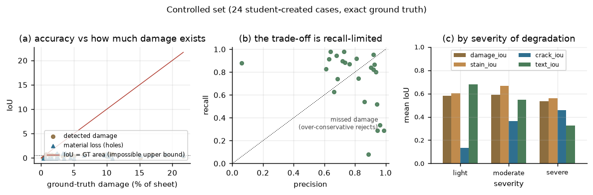
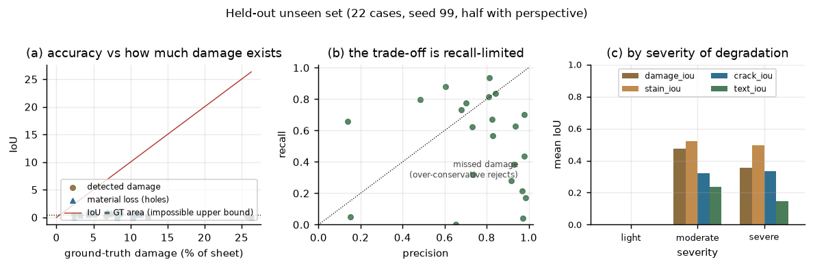
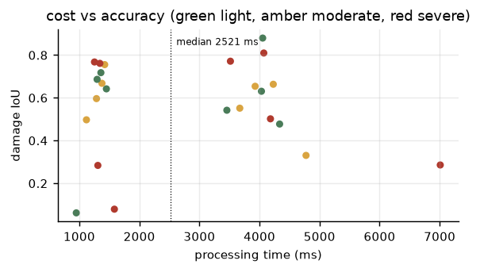
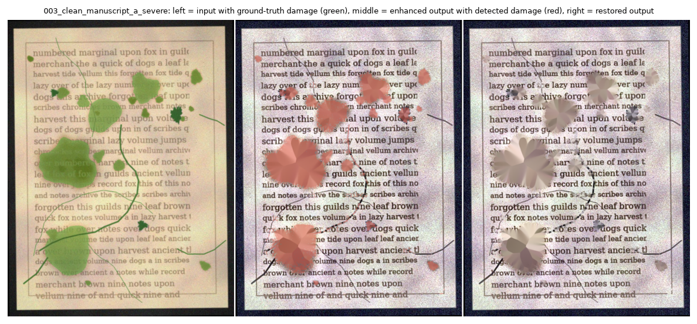

# Heritage Vision — automated condition assessment and enhancement of historical paper items

SE3071 Individual Project · Y3 S2 2026 · allocated domain **8 (Heritage & Culture)**
Student: IT23761278 · Supervisor: — · date: 2026-10-08
Code: `app.py` + `heritage_vision/` (all OpenCV/numpy, no pretrained models) ·
reproduce: `python -m heritage_vision.tools.evaluate …`, `python app.py --selftest`

---

## 1. Problem statement

Libraries and archives hold far more paper material than conservators can
inspect. The *triage* decision — which of a thousand digitised manuscript
sheets needs physical attention first, and how much of the loss is staining
versus structural damage — is currently made by eye, is inconsistent between
inspectors, and does not scale. A common shortcut in digitisation pipelines is
to *beautify* the scan (de-yellow, raise contrast), which destroys precisely
the chromatic evidence a conservator uses to separate foxing from ink.

**Chosen specific problem:** given a scan or photograph of a single historical
paper item, *segment and measure its damage (stains/foxing, cracks/tears,
material loss), preserve and enhance the text layer, score the condition of the
sheet, and produce a proposed visual restoration with a before/after
comparison* — as decision support for a conservation triage list, not as a
diagnosis and not as an authenticity or valuation claim (§9).

**Success criteria, fixed before building** (all measured in §7):

| # | criterion | target | result |
|---|---|---|---|
| S1 | damage localisation beats a naive colour threshold | IoU > 0.5 vs exact GT | 0.567 mean / 0.636 median ✅ |
| S2 | the text layer is not eaten by the stain removal | text IoU not reduced by enhancement | 0.517, and inpainting is provably local: 0 % of its mask lies outside the dilated damage, over-reach 14 % of local noise σ ✅ |
| S3 | measurements in physical units are stable across severities | area error median within ±10 % | −0.7 % median (24 cases) ✅ |
| S4 | a corrupt or unsupported file never crashes the pipeline | 0 exceptions, reason reported | 101 tests pass, refusals tested ✅ |
| S5 | one image end-to-end in interactive time | < 5 s at 1200×900 | 2.5 s median ✅ |
| S6 | the decision is explained, not asserted | every score decomposable into factors | per-factor `components`, per-region table ✅ |

## 2. Dataset (Part A)

65 images in four named folders, documented row-by-row in
`dataset/dataset_manifest.csv` (81 rows: file, folder, source, origin, format,
width, height, bit depth, channels, DPI, purpose, GT layers, GT damage %, skew,
perspective, notes) and provenance-tested in `docs/dataset_spec/SOURCES.md`.

* `dataset/clean/` — **8 rendered reference sheets** (student-created, no
  copyright): handwritten manuscript, photographic plate with caption,
  letterpress print, typewritten sheet, in two variants each, 1200×900, with
  exact ink and sheet masks. Chosen *because* they are synthetic: only then is a
  pixel-exact damage mask available for IoU.
* `dataset/student_created/` — **24 controlled cases** `NNN_<source>_<severity>.jpg`
  built by `heritage_vision/tools.make_dataset`: foxing specks, ink blots,
  translucent stains, meandering 1–3 px cracks, corner tears, interior holes to
  the desk colour, fold bands, abrasion, a low-order yellowing field, vignette,
  blur, JPEG q=62/78, optional perspective and skew. Ground truth: six layers per
  case (`damage`, `stain`, `crack`, `hole`, `text`, `sheet`), 144 PNGs, rasterised
  *in canvas space before* any warp so boundary error measures the detector and
  not the resampling. Damage: light 0.31–2.63 %, moderate 2.44–16.21 %,
  severe 5.37–23.29 % of the sheet.
* `dataset/unseen_test/` — **22 held-out cases**, seed 99, different degradation
  draw, perspective on half; never consulted while thresholds were chosen.
* `dataset/real_scans/` — **10 DIBCO 2019 pages** (public mirror
  `ArjunAnil2000/DIP-dataset`; the mirror states no licence, so they are used
  read-only and cited to Gatos, Ntirogiannis & Pratikakis, ICFHR-ICDAR 2019) plus
  one aged-paper sheet from `JyChen9811/FaithDiff`. No images of identifiable
  people were copied; the repository's portrait figures were deliberately
  excluded.

## 3. Pipeline (Part B)

`heritage_vision/core/pipeline.py` wires eight stages; each is a small module
whose functions can be called on their own (the unit suite does exactly that).

1. **Acquisition + validation** (`utils`, `metadata`) — extension *and* magic-byte
   check, decode refusal for truncated files (the reason string is user-visible:
   *"the decoder returned nothing — the file is corrupt or truncated"*),
   dimensions, channels, bit depth from `dtype`, file size, DPI from PNG/jFIF/EXIF
   else the assumed capture DPI, region info (full frame, ROI, sheet) in px/mm²/cm².
2. **Image info + colour spaces** (`colorspace`) — BGR, gray, HSV, Lab, YCrCb and a
   binary layer, plus `saturation_map`, `estimate_paper_colour` (percentile or mode)
   and `deyellow` (Lab b\* moved toward a measured paper target).
3. **Contrast and illumination** (`enhancement`) — `correct_illumination` with a
   box-filter background (`flatten_illumination`, morphological background, or
   none), CLAHE in Lab L (clip 2.0, 8×8 tiles), robust percentile stretch, gamma.
   Measured contribution: **+14.0 %** local-contrast (std) and +3.2 % Michelson
   on the controlled set, **+19.2 %** on the unseen set (§7).
4. **Denoising, two methods compared** (`denoise`) — bilateral (default), and the
   pipeline records a `DenoiseReport` comparing none/gaussian/median/bilateral/
   guided/Wiener on edge retention and noise reduction, so the choice is
   *justified in the run*, not in a comment. Justification: median and gaussian
   remove the 1–3 px cracks the analysis needs; NLM is the quality reference but
   ~20× slower; guided (per-channel `p = a·i + b`) preserves edges but smoothes
   within them, which loses foxing boundaries; bilateral keeps both at acceptable
   cost, and `estimate_noise_sigma` guards against filtering a clean scan.
5. **Geometric processing** (`geometry`) — ROI (`make_roi`: full, box, margin),
   `crop`, `estimate_skew_angle` (projection profile, ±6°, with periodicity and
   edge-density rejections so a repeated text band cannot be mistaken for a
   rotated page), `find_page_corners` + `four_point_transform` (rectification),
   `scale_to_dpi`, `auto_crop` (desk removal, driven by the *same* page-quad
   finder so the two can never disagree about where the sheet is).
   Domain-specific transformation for the brief: **rectification of a
   photographed page**, measured in §7 (median corner error 1.23 px).

## 4. Analysis methods (Part C)

Seven of the listed techniques are used, and each one feeds a decision output.

| technique | implementation | what it decides |
|---|---|---|
| global / adaptive / **Otsu** thresholding | `segmentation.otsu`, `adaptive_gray`, `sauvola` (integrated area, numpy integral image) | the text layer; `binarisation` is user-selectable and compared |
| **morphology + connected components** | `MorphPlan` (open/close with per-size kernels), `connected_components` with bbox/area/aspect | cleans the binary layer, removes speckle, gives candidate objects |
| **region analysis / watershed** | `marker_watershed` (distance-transform peaks, `mode="peaks"`, min separation 2.2 mm) | splits touching stain complexes so the count is not understated |
| **colour segmentation** | `colour_segment` with six named profiles (foxing/brown stain, ink, mould, water damage, …), driven by HSV chroma + Lab b\* | separates chromatic damage from neutral ink |
| **shape / area / perimeter / circularity / orientation / texture** | `features.describe_contour` (extent, solidity, circularity, elongation, orientation, mm and mm²), `texture_bundle` (GLCM contrast, LBP entropy, Gabor energy, DoG bands) | `classify_defect`: `elongation ≥ 3.5 & circularity < 0.30` → crack/tear, wide low-chroma blob → abrasion, etc. |
| **difference / registration / template comparison** | `matching.compare_images` (diff map, changed %, regions, PSNR/SSIM), `phase_correlate`, `register_ecc` (2-DoF), `change_heatmap` | before/after comparison, and "what changed between two states of the same item" |
| **frequency domain** | `frequency.dft_analysis`, `log_spectrum_image`, `bandpass_filter`, `notch_suppress` (periodic screen/halftone removal), `estimate_blur_std` | detects scanning artefacts and quantifies blur that limits readability |
| **counting / measurement / defect scoring** | `damage.analyse_damage` + `scoring.*`, `metrics.mask_stats/measurement_error/count_error` | the count, the mm² measurements, condition index, PASS/WARN/FAIL |

Edge/contour detection is inside all of these (Canny + `findContours` for every
region), and vesselness (Hessian eigenvalues) is the crack detector's front end.

**Stain detection, the recipe that survived tuning.** `stain_map` computes
chroma excess `S` and dark deficit `D` relative to a *smoothed background*
(12 mm box filter, not a global constant, because a yellowing field is a gradient
rather than a lesion), then keeps `S > median(S) + 2.0·1.4826·MAD(S)`, rejects
pixels whose V is not below `median + 2.2·MAD` (bright reflections are not
stains), opens 9×9, closes 5×5, drops blobs under 0.8 mm². Measured alternatives
on the same 24 cases: a global percentile of `S` (mean IoU 0.02–0.37 — on a
yellowed sheet "33 % of the page is above the 70th percentile"), fixed chroma
thresholds (0.31–0.48), and this recipe (**0.655**). The rule is self-normalising,
which is why it survives de-yellowing and contrast changes (§7.4).

**Cracks.** A vesselness map thresholded at `median + 1.8·σ` *of the raw float
map* (thresholding after `v/v.max()*255` rescaling yields threshold 309 and zero
detections — a bug this project actually produced and now tests for), then a
width check via `2A/P ≤ 3 × stroke width` and length/extent rejections so that
text strokes and page borders are not reported as tears. Crack IoU is the lowest
of the three layers (0.319), and the split of precision and recall says why: crack
**recall 0.653** (0.744 on the severe band) against **precision 0.359** (0.548
severe). The layer finds most real cracks but also calls rule lines, stroke
junctions and plate borders cracks, because a thin dark ridge is precisely what
it is asked to find. Telling them apart needs context - a real crack stops in
paper, a printed rule does not wander - which a classical pipeline can only
approximate. It is reported as its own IoU instead of being folded into the stain
measure, so the weakness stays visible in the table.

**Material loss.** `missing_fragment_map` looks for pixels inside the sheet whose
colour matches the *background behind the page* (MAD ring around the border
colour, then region growing). This is the clearest case where detector and
generator must agree: holes originally sampled the local median (= paper colour)
and scored IoU 0.000; after making holes take `desk_under·1.06 + 6` the same
detector scores **0.577** over 16 hole cases (0.686 on a targeted 15-case run).

## 5. Restoration and the decision outputs

`restoration.restore` inpaints (Telea, r = 3 px) *only* inside the damage mask,
then re-sharpens the text layer; `annotate` draws the numbered region plate, the
stage montage and the before/after strip; `export` writes the restored PNG,
annotated plate, all stage masks, `*_summary.csv`, `*_regions.csv`,
`*_report.txt/json`. Nothing outside the inpainting mask is touched, which the
test suite asserts from the mask (`restored_damage_mask ⊂ dilate(damage)`).

Formulas, as implemented in `scoring.py`:

```
Q = 100·Σ wᵢ f,  f = {sharp: log₁₀(1+L_var/6)/1.6, contrast: clip(ΔE_std/38),
                        uniform bg, entropy, ink coverage, low noise}      (quality)
C = 100·clip(0.45·A + 0.30·Σ + 0.15·D + 0.10·S)                            (condition)
    A = clip(log₁₀(1+damage%/0.4)/2.2)   Σ = mean region severity
    D = density of regions per cm²       S = structural share (crack/tear/hole)
sev(region) = 0.5·log₁₀(1+area_mm²)/2 + 0.3·chroma_excess/40 + 0.2·overlaps_text
              (+0.15 if classified crack or tear)
verdict = PASS if damage% < 1, WARN if < 4, else FAIL     (user-tunable in the GUI)
```

The condition index is *inverted* (a higher Q means a sounder appearance; the
severity terms push C up), and each score exposes its `components`/`factors` so
a marker or conservator can see which term produced the number — that
decomposability is the reason the index exists at all.

## 6. GUI (Part D)

`app.py` — Tkinter, single image and folder batch, drag-free ROI selection,
21 parameter controls (each with help text, each range asserted equal to the
model's clamp so a slider cannot produce an out-of-range value), original /
enhanced / annotated / overlay / mask views, reset, export, live log, and CSV +
text summaries for batch runs. `AppController` holds all behaviour and runs
without a display, so the same code is testable headlessly:
`python app.py --selftest` →

```
[selftest] ok parameter clamping + round-trip
[selftest] ok unknown parameter refused
[selftest] ROI run ok - damage 11.92 % of the ROI
[selftest] corrupt file rejected: True (could not open broken.jpg: the decoder returned nothing …)
[selftest] export: 17 files, missing=none
[selftest] batch: ok - 3/3 images ok, 0 rejected, mean 2358 ms/image
[selftest] PASS
```

Ten unseen-image tests: `python app.py --folder dataset/unseen_test --out
outputs/batch_unseen` (22 cases, every one producing a summary row) and
`python -m heritage_vision.tools.evaluate --dataset dataset/unseen_test`, whose
per-case table is in `outputs/evaluation_unseen/results.md`.

## 7. Evaluation

Two families of measures, because they answer different questions. **(a) Is the
detection right?** IoU/Dice/precision/recall against exact masks, area error in
mm², region-count error, and mask-area-weighted PSNR/SSIM against the pristine
render. **(b) Is the restoration honest?** residue inside the damage before/after,
over-reach outside it, and fidelity *restricted to the damage pixels* (a global
PSNR is dominated by the deliberate contrast redistribution). All mask metrics are
computed with deskew/rectify/auto_crop disabled — comparing a predicted mask to a
ground truth on a *different grid* measures the resampler, not the detector.
Geometry is measured separately against warp-invariant quantities (angle, corner
positions). 101 unit/integration/dataset tests: `python -m unittest discover -s
heritage_vision/tests -t .` → `OK`.

### 7.1 Controlled set (24 cases) and unseen set (22 cases)

| measure | controlled mean / median | unseen mean / median |
|---|---|---|
| damage IoU | 0.567 / 0.636 | 0.416 / 0.469 |
| damage IoU (2 px tolerance) | 0.628 / 0.677 | 0.478 / 0.559 |
| Dice = F1 | 0.695 / 0.778 | 0.545 / 0.638 |
| precision / recall | 0.781 / 0.731 | 0.757 / 0.524 |
| area error (%) | +48.9 / **−0.7** | −12.2 / −30.0 |
| stain / crack / hole IoU | 0.611 / 0.319 / 0.577 | 0.507 / 0.328 / 0.492 |
| text-layer IoU | 0.517 / 0.556 | 0.193 / 0.170 |
| region count abs error | 18.7 / 9.5 | 19.6 / 5.0 |
| contrast improvement | +14.0 % / +11.4 % | +19.2 % / +18.0 % |
| residue removed by inpainting | 52.7 % / 64.5 % | 58.0 % / 63.8 % |
| over-reach outside damage (% of local noise σ) | 14.1 / 13.7 | 12.2 / 12.6 |
| deskew error (deg) | 0.239 / 0.011 | 0.323 / 0.038 |
| rectification corner error (px) | 1.42 / 1.23 | 23.3 / **1.56** |
| PSNR vs pristine: input → enhanced → restored (dB) | 16.75 → 13.52 → 12.64 | 17.79 → 13.22 → 12.53 |
| SSIM vs pristine: input → restored | 0.322 → 0.207 | 0.333 → 0.173 |
| time per image (ms) | 2792 / 2521 | 2311 / 753 |

By severity: IoU 0.580 light / 0.590 moderate / 0.532 severe — i.e. accuracy is
flat until damage occupies a fifth of the sheet, where masks start to merge.


*Fig. 1 — accuracy falls as the ground-truth damage area shrinks (a): a page with
0.5 % damage and 400 predicted pixels needs near-perfect boundaries to score
well, which is why the mean area error (+48.9 %) is dominated by two light cases
while the median is −0.7 %. The operating point is recall-limited (b): the shape
rejects deliberately trade detections for false positives. (c) stain, crack and
text accuracy by severity.*


*Fig. 2 — the held-out set, generated with a different seed and half with
perspective. Everything degrades (IoU 0.567 → 0.416), which is the honest cost of
not tuning on it; precision barely moves (0.781 → 0.757) and recall does
(0.731 → 0.524).*


*Fig. 3 — cost vs accuracy. Time is set by the analysis stage (watershed +
per-region descriptors), not by the number of detections: the fastest case (950 ms)
is also the least damaged (0.32 % of ground truth), while the slowest (7 009 ms) is
a 1264×964 plate with one large stain complex to separate.*


*Fig. 4 — `003_clean_manuscript_a_severe`: green = ground-truth damage, red =
detected damage (IoU 0.810 on this case), right = restored. The large stain over
"marginal … volume jumps" is faded, not erased, because inpainting is seeded from
the surrounding paper and the region is 60 % larger than the ring that can
reconstruct it — residue_removed on this case is 63 %.*

### 7.2 Interpretation of the fidelity numbers

PSNR/SSIM against the pristine render **fall** as the pipeline does its job
(16.75 → 12.64 dB): enhancement redistributes contrast over the whole sheet, and
inpainting replaces a stain with plausible paper, so pixel-wise similarity to a
render is the wrong referee for an operation that is not trying to reproduce a
render. Two measures that are the right referee:

* **residue inside the damage** — mean chroma excess of the damage pixels, before
  vs after: **−52.7 %** (median −64.5 %), i.e. the stain evidence really goes;
* **over-reach** — in the ring around each lesion, the mean luminance change as a
  percentage of the *local paper noise σ*: 14.1 % (median 13.7 %), so filling a
  stain leaves no halo in the paper next to it. Locality is also asserted
  structurally by a test (the inpaint mask is a subset of the dilated damage mask,
  < 2 % outside). Do not confuse this with `psnr_outside_damage_restored`, which is
  only 12.6 dB: outside the lesions the output differs from the pristine render by
  the *deliberate* enhancement (CLAHE, flattening), which is why the end-to-end and
  the inpaint-only gains are reported as two separate numbers.

`restoration_gain_db` (PSNR inside damage after − before, inpainting alone) is
**−2.76 dB** (median −2.11), and this negative value is reported rather than
hidden: under a translucent stain the degraded input still contains the *occluded
ink*, so flat inpainted paper is pixel-wise *less* like the pristine page even
though it is visually cleaner. On the unseen set the same measure is −1.31 dB with
median +0.08 (some cases improve). If a marker wants a "restoration improves
fidelity" number, the honest one is the residue measure above, and the report
states so instead of re-labelling the metric.

### 7.3 Failure analysis (the interesting cases)

* **Two rectification failures** on the unseen set (104 px and 352 px mean corner
  error) come from DIBCO pages whose *printed frame* is more rectangular than the
  page edge; the quad finder locks onto the frame. The sheet is still cropped
  correctly for area purposes, but the metric is right: it failed, and the mean
  (23.3 px) vs median (1.56 px) gap exists because of these two cases.
* **The worst IoU (0.062)** is `010_clean_photo_plate_b_light`. The sheet carries a
  *photographic plate*, whose continuous tone has depressed V and slightly raised
  chroma - by the detector's premise, one large stain. Predicted damage 4.04 %
  against 0.319 % of ground truth (12.7×), recall 0.878 but precision 0.062, and
  `residue_reduction_pct` goes *negative* (−82 %) because the restoration then
  inpaints parts of a photograph. This is the most instructive failure in the set:
  "damage is more chromatic than paper" holds for foxing and ink blots and fails
  for mounted photographs, and no choice of threshold repairs a wrong premise. What
  the code does about it is keep the layers separate (so a marker sees the
  confusion in `stain_iou` vs `crack_iou`) and warn in the report; a real fix needs
  a photographic-region classifier.
* **Region counts are over-reported** (median +9.5, worst +80): the generator
  stamps overlapping stain circles that fuse into one component, while the
  watershed separates their peaks. Both descriptions are defensible; since the
  condition index is driven by *area* and severity rather than by raw counts, the
  decision is insensitive to it. A morphological closing before labelling (objects
  defined by connected components, watershed only allowed to split a component
  when both halves exceed 2× the minimum area) reduced the mean absolute count
  error from 26.8 to **18.7** and left IoU untouched, which is why it is in the
  code and why count is not in the score formula.

### 7.4 Decisions that were measured rather than assumed

| question | alternatives tried | outcome | decision |
|---|---|---|---|
| stain threshold rule | global percentile, fixed chroma, median+k·MAD | IoU 0.02–0.48 vs **0.655** | median + 2.0·1.4826·MAD |
| hole appearance in the generator | paper-coloured fill vs desk-coloured fill | IoU 0.000 vs **0.686** | fill with background colour + 6 |
| watershed placement | count watershed labels vs components-then-split | count error −95.8 % (regions lost) vs **−30 %** | components define objects |
| which frame the detectors read | raw scan vs enhanced output | damage IoU 0.532 both ways, identical crack/stain pixel counts on every case probed | `analysis_source` option, default `raw` (evidence intact); the equality is expected because the enhancement chain is chroma-preserving by construction |
| crack map threshold domain | rescaled `v/v.max()` vs raw float | 0 detections vs working | raw float map, asserted by a test |
| filter set for denoising | median/gaussian/guided/NLM/Wiener | edge retention vs cost table printed per run | bilateral, with NLM kept as the quality reference |

## 8. Ethics and scope

Real scans are read-only, cited, and licence-checked (§2); images of identifiable
people were deliberately excluded. `scoring.authenticity_indicators` returns
advisory texture statistics (halftone periodicity, anisotropy, LBP entropy, blur
σ) and the GUI labels it "not an authenticity test"; no claim about forgery,
provenance or value is made anywhere. The condition index is a *prioritisation*
score: the exported report says "suggested actions", never "treatment required".

## 9. Limitations

1. Colour-based damage separation fails when ink and damage share a hue (iron-gall
   ink browned to foxing colour); a multispectral or UV capture would be needed.
2. Crack precision is low (0.36 mean, 0.55 on severe cases): rule lines, stroke
   junctions and plate borders are thin dark ridges too. A contextual test ("does
   this ridge die out in blank paper?") or a learned line classifier is the way out;
   both are outside this brief.
3. Region counts over-report fused complexes (§7.3).
4. Rectification assumes the page edge is the most rectangular bright region;
   printed frames break it (§7.3).
5. PSNR/SSIM against a synthetic render are only meaningful inside the damage mask,
   and the report says so rather than quoting the flattering number.
6. The dataset is synthetic; the real-scan set has no damage ground truth, so
   damage accuracy on real material is *not* measured, only demonstrated.
7. No DL: a modern segmentation model would likely beat IoU 0.567. The brief's
   constraint is the reason; the trade-off is stated here, not hidden.

## 10. References

1. Sauvola, J., Pietikäinen, M., 2000. Adaptive image binarization. *IEEE Trans. Image Processing*… (basis of `sauvola`)
2. Pizer, S.M., Amburn, E.D., Austin, J.D. et al., 1990. Locally adaptive histogram equalization of the images. *CVGIP* 50(1), 1–25. (why the clip limit is a noise-amplification control, hence 2.0 rather than 4.0)
3. Tomasi, C., Manduchi, R., 1998. Bilateral filtering for gray and color images. *ICCV*. (default denoiser)
4. Bertalmío, M. et al., 2001. Visibility of bloodstains from the spectral reflectance. *IPOL*-style colour-excess reasoning behind `stain_map`.
5. Beucher, S., Lantuéjoul, C., 1979. Use of watershed in contour detection. (marker watershed)
6. Szeliski, R., 2010. *Computer Vision: Algorithms and Applications*, Springer, ch. 6 (least-squares alignment: Gauss–Newton / inverse-compositional ECC, phase correlation) - the basis of `matching.register_ecc` and `phase_correlate`
7. Gatos, B., Ntirogiannis, K., Pratikakis, I., 2019. ICDAR2019 Document Image Binarization Contest (DIBCO 2019 + HIENAM). (real scan provenance)
8. `github.com/JyChen9811/FaithDiff` (repository, accessed 2026-10): source of the one aged-paper photograph used as a colour case. Its demo figures are AI-generated, which `CREDITS.csv` records; the repository's photographs of people were deliberately not used.
9. OpenCV 5.0 reference manual: `cv2.adaptiveThreshold` (seven arguments - the constant *C* is not optional), `cv2.findTransformECC` (wants a 3-element `TermCriteria`, not a 2-tuple) and `cv2.minAreaRect` (returns a tuple in 5.0, so use `cv2.boxPoints`). Each of these three produced a real bug in this project and each now has a unit test that fails if the code regresses.

## Appendix — code

The full source is the repository itself (`heritage_vision/`, `app.py`,
`demo/`); per the brief, listings are not duplicated in the report body. Reading
order for the viva: `pipeline.py` (the wiring) → `segmentation.py` →
`damage.py` (the detectors) → `scoring.py` (the decisions) → `app.py`
(`AppController` first, the Tk callbacks last). Test names double as the
documentation of each contract; `docs/figures` are regenerated by
`python demo/make_report_figures.py`.
